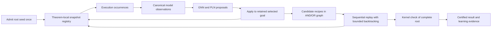

# Lean snapshot retention and replay-based proof combination

Status: proposed architecture; no runtime changes implemented by this document.

Prepared on 2026-10-24 for `AC-branch`. Implement stages in order and satisfy each
exit gate before proceeding. The final application migration is atomic across
search, inference, RL collection, rewards, and result reporting.

User-confirmed requirement: final search success requires a kernel-checked
complete proof. A replayed snapshot with an empty active goal list is not the
final certification boundary.

## Objective and scope

Stop reconstructing intermediate search goals from serialized expressions.
Retain Lean snapshots during each theorem search, explore alternative tactics
against those snapshots, and combine speculative branch recipes by replaying
them sequentially in one compatible Lean execution. Certify the resulting root
proof with the Lean kernel before reporting success or assigning terminal
success reward.

The scope shift is that a search obligation now has an execution occurrence:
a particular metavariable in a particular retained snapshot. A canonical model
goal alone no longer identifies executable state or sufficient proof evidence.
The executor, graph propagation, RL action accounting, client allocation
bookkeeping, and completion reporting must support that distinction together.

Deliver this across three repositories:

| Repository | Inspected revision | Responsibility |
| --- | --- | --- |
| Mathematics-ai-atp, current `AC-branch` | `54d7cefe04aed980734798f06528ed80c71b81ac` | Registry, goal-oriented hypergraph, replay coordinator, model bindings, RL integration |
| `https://github.com/123nol/Pantograph`, `client_centric_repo` | `fe57f98d85a3fb6b9bdd32f9e725bdda1c721449` | Snapshot inspection, transition provenance, native proof completion and kernel certification |
| `https://github.com/123nol/Pantograph-Client`, `main` | `d1dac7e8a8ea296192e7a5b2616114b73e0812b7` | Public typed operations, versioned wire contract, bounded allocation bookkeeping |

Recheck these revisions and dirty state at implementation time. They describe
the inspected basis, not permission to discard later changes. Work in reviewed
fork branches or isolated worktrees. Do not modify downloaded reference source
or replace the currently used executable while developing the companion build.
Writes outside this application's writable workspace require the appropriate
workspace access or tool approval. Publication, merging, and deployment remain
separate actions.

This is an AC implementation plan. It does not silently modify MCTS selection,
simulation, or backup behavior. A later MCTS port must inspect those consumers
against the tested shared interfaces.

## Boundaries to preserve

- Preserve the existing normalized model S-expression schema, graph feature
  ordering, prepared artifacts, checkpoint parameter shapes, and vocabulary.
- Preserve one independent REPL per collection worker and the collection barrier
  before the optimizer update. Multiple workers may still share one GPU.
- Keep root dataset admission and reconstruction. Retention does not recover
  context that the initial record omitted.
- Preserve assumption binders, local `let` definitions, dependency order, local
  instances, and universe information when materializing the initial seed.
- Preserve explicit executable/project paths and GNU `stdbuf -oL` startup.
- Retain AND/OR goal-oriented search and PLN ranking. PLN supplies no proof
  evidence and may not discard required obligations.
- Keep handles, registries, and server state IDs out of training examples and
  checkpoints. Persist portable action recipes and certificate records instead.
- Do not add a selectable reconstruction backend, protocol fallback, or old/new
  success flag. Development components remain disconnected until the atomic
  migration. Thereafter every production caller uses the new contract.

Certification proves the admitted root statement under the recorded environment
and axiom policy. A dataset intermediate state is not automatically identified
with its original source theorem. Verifying that source relationship is outside
this plan.

## Current implementation and observed constraints

1. `hybrid_reasoner/joint_inference.py: PantographExecutor.apply` converts every
   returned goal to a canonical `Goal` and releases the result allocation.
   `_expand` subsequently releases the input allocation. Later nodes are
   materialized again using `materialize_seed`.
2. `TacticOutcome` contains canonical subgoals, not a retained result or selected
   obligation. An empty subgoal list currently means success for that branch.
3. `ProofHypergraph` currently creates separate child nodes with one incoming
   parent edge. It does not merge identical nodes across parents. Canonical
   fingerprints are used for ancestor-cycle checks, not general transpositions.
   Correct the implementation's explanatory comments when migrating it.
4. `NodeStatus.SOLVED`, childless edges, and AND propagation feed result
   reporting, `search_harvest.py`, `pln_reward.py`, and curriculum decisions.
   `proof_trace()` returns a nested description; it does not execute that proof.
5. The standalone client already supports `goal_index`, immutable input states,
   scope ownership, cancellation cleanup, and session-bound handles. This work
   extends those components instead of introducing a second transport.
6. With automatic mode enabled, the REPL returns unassigned siblings alongside
   goals produced by the selected tactic. Those siblings are not new children
   of the selected obligation. Returned goal order can change.
7. `goal.continue` resumes goals using one saved metavariable context. It is not
   a merge operation for independently modified contexts.
8. `Validation.lean` inspects dependencies and assignments. Its checked flag
   does not certify a complete theorem with the kernel.
9. The client scope currently keeps strong references to released Python state
   objects until scope exit. Bounding Lean allocations alone would leave
   Python retention unbounded during a long search.
10. The raw replay decoder rejects unresolved term/universe metavariables.
    Live intermediate execution must not pass through that decoder. The model
    serializer already has a normalized `(:metavar)` form; its graph/vocabulary
    behavior requires an explicit regression gate.

Small local diagnostics confirmed that either side of `True ∧ True` can be
selected without `case`, that separate alternatives retain separate assignments,
and that their results are not automatically combined. For
`∃ n : Nat, n = 0 ∧ n = 1`, assigning witness `0` permits the first equality and
leaves `0 = 1`; assigning witness `1` permits the second and leaves `1 = 0`.
Do not write tests assuming `rfl` can assign a separately introduced opaque
witness hole; the inspected binary rejected that implicit assignment.

## Alternatives considered

| Route | Benefits | Costs / reason for decision |
| --- | --- | --- |
| Improve reconstruction and retain no snapshots | Lowest change to search bookkeeping | Cannot preserve omitted constraints; continues intermediate reconstruction. Not selected. |
| Keep reconstruction during exploration and replay only complete candidates | Can expose composition failures early in development | Retains the execution-fidelity problem during search. Useful diagnostic baseline, not a production backend. |
| Replace goal search with whole-snapshot OR search | Compatible assignments remain together; simple execution semantics | Changes the meaning of graph nodes, backup values, search budgets, and critic targets. Not selected for this migration. |
| Retain snapshots, keep goal-oriented search, combine through replay | Preserves model inputs and much of the existing search structure; removes intermediate reconstruction | Needs occurrence identities, bounded ownership, candidate enumeration, replay conflicts, and certification. Selected. |
| Merge metavariable contexts or substitute separately exported proof terms | Could reuse more parallel work directly | Requires general constraint reconciliation and environment/declaration transport. Explicitly excluded. |

Do not infer that syntactically different contexts are incompatible or that
matching model expressions prove compatibility. The replayed Lean execution
and final kernel check establish the accepted result.

## Architecture

### Distinct representations and identities

| Component | Definition and purpose |
| --- | --- |
| Canonical `Goal` | Immutable model observation: target, visible ordered locals, model expressions, and model fingerprint. Used for GNN/PLN inputs and durable samples. |
| `SnapshotRecord` | Registry entry owning one client-issued `TacticState` allocation, its root lineage, leases, and accounting metadata. |
| `ExecutionOccurrence` | One logical obligation observed in one snapshot, identified by a search-local occurrence ID, snapshot key, and Lean metavariable ID. |
| `ObligationKey` | Portable logical address rooted at the theorem obligation and extended by recorded tactic-step identity and direct-child position. Not a server handle or printed name. |
| `DeclarationKey` | Logical address of a local declaration, anchored in the admitted root or in the transition that introduced it. Resolves model argument selection into the current Lean context. |
| `CandidateRecipe` | An immutable choice of tactic attempts and child recipes that may solve an obligation. Contains structured arguments and provenance, not a claim of certified success. |
| `ReplayAttempt` | One bounded attempt to execute a recipe combination in a compatible snapshot sequence. Records actual observations and effects. |
| `ReplayContinuation` | Pending obligations and their current occurrences in one retained replay snapshot when stored recipes cannot finish the combination. Uses the same proposal/executor/graph components to search that actual state. |
| `ProofCertificate` | Kernel-check result tied to the exact admitted root, environment, dependency policy, proof identity, and replay artifact. |

The registry key includes the worker/client session, theorem scope, and allocation
identity. A metavariable ID is interpreted only inside a compatible lineage;
it is not globally unique across independent alternatives or restarted workers.

A graph node represents an occurrence/version. Multiple versions may share
model feature cache entries, but never execution handles, completion evidence,
action stashes, or solved status solely because their fingerprints match.

### Ownership and lifetime

`PantographStateScope` owns the wire allocation lifecycle. The theorem-local
registry is its only application-level allocation controller. Graph nodes and
replay attempts hold leases; they never call `scope.release` directly.

Each result allocation is registered before any await that can lose its
ownership. Executor results transfer a lease to the caller. Linking an accepted
result transfers that lease into registry-owned graph/replay records. Discarding
an outcome releases its lease immediately, including decoding/linking failures.

An allocation is released once its last lease is gone. Pin the admitted root,
active tactic inputs, replay rollback anchors, and in-flight verification
inputs. Several sibling occurrences may lease the same snapshot. Removing one
sibling cannot invalidate the others.

Scope exit deletes every remaining allocation. If cancellation or a transport
error makes deletion uncertain, retire the session and invalidate all registry
references. Restarted workers begin a new theorem attempt; old IDs cannot resume.

### Transition accounting and obligation completion

Extend the Lean transition result with checked provenance from the actual saved
contexts and tactic execution, including:

- selected obligation ID and root lineage;
- ordered direct subgoals produced by the tactic before automatic sibling
  resumption;
- surviving prior siblings and their actual current observations;
- additional reachable obligations found during dependency validation;
- obligations assigned, delayed, or affected by shared assignments;
- enough local-declaration provenance to maintain argument bindings;
- pending or completed status for queried obligations, including assigned
  obligations no longer listed as active goals.

Do not classify these categories by subtracting pretty-printed goal strings.
Keep direct-child ordering separate from PLN ordering. Additional dependencies
may be shared or external to the focused branch; record them without pretending
they are independent new children. Conservatively use a joint replay task when
the dependency relation cannot be represented as an independent child list.

An obligation is locally complete only when Lean can instantiate its assigned
expression and the reachable proof/type/context dependencies without unresolved
term or universe metavariables or delayed obligations. Root completion also
requires no outstanding required goals and the kernel certificate. Assigned
parent metavariables can still contain unfinished child proofs.

### Candidate status versus accepted evidence

Replace the current use of `SOLVED` as both structural readiness and proof
evidence. Use explicit candidate readiness and replay-attempt outcomes:

- no candidate yet;
- candidate recipe available;
- replay pending;
- replay complete for this compatible execution;
- recipe-combination conflict;
- kernel-certified root;
- interrupted, resource-limited, or infrastructure-unknown.

An AND edge becomes candidate-ready when its obligations have recipes. It does
not become certified merely because each child has a recipe. An OR node retains
alternative candidates after its first candidate becomes ready.

Replay conflict belongs to a particular combination and input occurrence. It
does not mark the tactic or logical goal globally impossible. Existing `DEAD`
and closure reasons must retain their distinction between exhausted search and
missing evidence.

`graph.is_solved()` must mean a valid root certificate is attached. Add explicit
candidate queries rather than changing its meaning by caller. Reports,
curriculum, evaluation, harvesting, and smoke scripts all use this definition.

### Replay-based combination

1. Select candidate recipes lazily from the goal hypergraph. Record the choice
   of each OR alternative and the original order of every AND edge.
2. Pin a common anchor in the same theorem/session. Start root verification at
   the admitted root anchor. Nested composition can reuse an accepted prefix.
3. Resolve the recipe's obligation to its current metavariable and current goal
   index. Never persist a numeric `goal_index` as a stable identity.
4. Resolve structured argument references against current declarations and
   render the tactic using the shared renderer. Do not reuse stale display
   names or substitute names by regular expression.
5. Apply the tactic. Register the successor before releasing anything. Use
   checked transition provenance to map direct-child addresses and refresh
   affected sibling observations.
6. Replay sibling recipes sequentially against the evolving snapshot. A child
   can be complete while other siblings remain active. A sibling already
   discharged by a shared assignment needs no fabricated additional tactic.
7. If a recipe is no longer applicable, retain a typed conflict and backtrack to
   a retained anchor. Try another candidate within the replay budget. Search
   may propose a fresh continuation from the actual changed occurrence.
8. When the root is complete, invoke kernel certification and persist the
   certificate plus portable replay artifact. Only then report success.

Retain existing metavariable/local identities only where the common lineage
establishes them. Newly generated identities can differ during replay. Correlate
them using recorded transition origins and direct-child/declaration slots.
Validate expected structural correspondence; if it is ambiguous, report a
conflict and search the actual occurrence. Do not match by normalized text or
assume fresh IDs are deterministic.

Shared assignments can change an existing sibling's target or local types.
Create a new occurrence/model observation for the changed state. Do not mutate
the old observation after it has an associated sampled action. Reused actions
must satisfy the actual model-graph fingerprint and declaration bindings before
they receive any learning credit.

Candidate enumeration must be lazy and bounded. Memoize failed combinations
using exact search-local anchor lineage, recipe choices, and the fixed execution
environment. A model fingerprint alone is not a valid conflict-cache key.
Do not run an eager Cartesian product of all child alternatives.

A fresh replay continuation records its current snapshot, pending obligation
addresses, and remaining budgets. New expansions attach to new occurrences in
that attempt; they do not overwrite or reparent the original speculative graph
nodes. The accepted recipe records the actual continuation. Replay and search
can therefore use the same expansion machinery without confusing historical
observations with the state that was ultimately certified.

### Complete-proof certification

Certification is a new native operation, not a Python interpretation of
`goals=[]`, `hasSorry=false`, or `validation.checked`.

The server records the exact root expression, universe parameters, and initial
trusted environment when starting the theorem. The certificate operation:

1. Instantiates the saved root assignment and checks all reachable term and
   universe obligations. Rejects unresolved holes, loose bound variables,
   unexplained free locals, missing dependencies, and incomplete delayed work.
2. Uses native expressions and native context abstraction. Ordinary assumptions
   become dependent binders; local definitions retain their values. It does
   not render a target to text and elaborate that text as a substitute.
3. Checks against the original root type, not a caller-provided replacement
   target or a normalized model expression. Root type changes must not silently
   specialize the certified statement.
4. Builds a temporary checked theorem declaration in an isolated environment.
   Use the pinned Lean version's kernel-checking path. In Lean 4.10's
   `Lean/AddDecl.lean`, `Environment.addDecl` can skip checking when
   `debug.skipKernelTC` is enabled. Force the checked path and test that option
   explicitly. `Meta.inferType` or `isDefEq` alone is insufficient.
5. Checks new reachable auxiliary declarations in dependency order against the
   fixed baseline. Rejects newly introduced axioms, admissions, unsafe
   dependencies, and missing or replaced baseline declarations. Do not accept
   a new declaration solely because it exists in the final saved environment.
6. Reports the transitive axiom dependencies. Trust the explicitly pinned
   imported baseline under its recorded axiom policy; a new search-time axiom
   is not an allowed way to complete a proof. Enforce the no-admission policy
   transitively, including imported dependencies used by the candidate.
7. Returns a typed receipt containing contract version, root/type/proof
   identities, environment/build identity, dependency/axiom evidence, and the
   checked result. The receipt is reproducibility metadata, not a cryptographic
   proof or an independent external checker.

Kernel rejection makes that candidate unacceptable. Verification timeouts and
transport failures supply unknown evidence. Verification must restore the
caller's state and environment even on failure and must not insert temporary
declarations into other search snapshots.

Persist the exact seed specification, original universe declarations, structured
replay recipe, required environment/build identities, and receipt. A fresh
session must be able to replay that artifact and obtain a new kernel check.
Pretty-printed proof text and live handles are not the durable artifact.

## Sequential implementation stages

| Stage | Deliverable | Production search changes? |
| --- | --- | --- |
| 0 | Contracts, baseline fixtures, and complete caller inventory | No |
| 1 | Native transition provenance and obligation inspection | Separate companion build |
| 2 | Native root kernel certification | Separate companion build |
| 3 | Standalone typed client and reclaimable released records | Tested development package |
| 4 | Application registry, argument identities, and retained executor | Components only |
| 5 | Candidate propagation and sequential replay/backtracking | Components only |
| 6 | Retention, replay, metadata, and memory budgets | Components only |
| 7 | One application migration, dependency pin, and learning-evidence change | Yes; all consumers together |
| 8 | Mathlib correctness, performance, and deployment verification | Release gate |

### Stage 0 — Freeze contracts, examples, and caller inventory

Deliverables:

- Confirm the three repository revisions, Lean toolchain, Mathlib revision,
  environment identity, and current dependency pin.
- Record a raw baseline for selected-goal execution, sibling resumption,
  assignment propagation, delayed assignments, local definitions, and scope
  cleanup. Freeze model graph/tensor fixtures for checkpoint compatibility.
- Finalize version-2 wire schemas for transition provenance, read-only obligation
  inspection, and root certification. Keep `modelSexpVersion=1`; the execution
  protocol changes independently of the model representation.
- Inventory every `TacticExecutor`, `TacticOutcome`, `_link`, `is_solved`,
  `proof_trace`, status backup, reward, curriculum, visualization, and fake-server
  caller. Include deterministic inference and `NullTacticExecutor`.
- Specify typed failure categories, recipe IDs, allocation handoffs, and the
  success/learning-evidence tables before writing runtime code.

Required examples:

- one-goal success and one-goal tactic rejection;
- `True ∧ True`, solving either side first;
- three identical sibling targets, preserving all three occurrences;
- a selected goal producing descendants while unrelated siblings survive;
- the conflicting existential-witness example from the diagnostics;
- compatible shared assignments that solve another goal as a side effect;
- dependent locals, local `let` values, instances, universes, shadowed names,
  hidden context-index gaps, and renamed locals;
- a goal absent from the active list with unresolved reachable dependencies.

Exit gate: reviewed schemas and all caller migrations are enumerated. Fixtures
distinguish local completion, complete replay, and kernel certification. No
production behavior changes in this stage.

### Stage 1 — Implement native transition provenance and inspection

Repository: custom Pantograph fork. Likely files: `Goal.lean`, `Protocol.lean`,
`Validation.lean`, `Serial.lean`, `Repl.lean`, and the existing Lean test suites.

Tasks:

1. Capture direct tactic-produced goals before automatic resumption. Return
   checked categories for existing siblings, reachable extra dependencies, and
   changed assignments. Do not infer direct children after lists are flattened.
2. Add a read-only `goal.inspect` operation for selected active or assigned
   obligations in a retained state. It must support a dependency that no longer
   appears in the active goal list.
3. Return native obligation/declaration provenance and pending/complete status.
   Keep model-visible serialization unchanged. Complete execution context
   inspection must not add hidden locals to the model observation implicitly.
4. Expose enough data to resolve current goal indices and local arguments after
   replay. Shared dependencies remain explicit even when normal output hides
   implementation details.
5. Preserve transactional restoration, failed-tactic rollback, error-message
   handling, and the existing sorry/unsafe transition checks.
6. Describe this as execution protocol version 2. Do not implement a second
   decoding path that guesses whether metadata is available.

Exit gate: native tests and raw fixtures cover nonzero selection, unchanged and
changed siblings, direct children, opaque witness holes, delayed assignments,
and read-only inspection. The original input snapshot remains usable after
successful alternatives and failed inspection. Model fixtures remain unchanged.

### Stage 2 — Implement native root kernel certification

Repository: custom fork. Add a focused certification module rather than placing
all logic inside command dispatch. Extend protocol fixtures and tests.

Tasks:

1. Retain original root/type/environment provenance independently of the active
   goal list and the selected-parent metadata.
2. Implement `goal.certify` with the complete-proof boundary described above.
   Requests identify an owned saved state; callers do not supply an alternative
   theorem type to make a failed candidate pass.
3. Reject unresolved term/universe holes, hidden remaining obligations, sorry,
   unsafe dependencies, new axioms, type mismatch, and unchecked auxiliary
   declarations. Check the unmodified root statement.
4. Verify with the pinned kernel in an isolated environment with kernel checking
   forced on. Make checking budgets explicit and return typed inconclusive
   results for resource exhaustion.
5. Produce stable, versioned proof/type/environment identities from native
   expressions and declarations. Do not hash pretty-printed names or transient
   state IDs as proof identities.
6. Rebuild in a separate checkout/build directory and record source/binary
   provenance. Retain the original executable for the baseline measurement.

Exit gate: a valid complete root certifies; false/incomplete/mismatched roots do
not. Include a controlled ill-typed metavariable assignment, a new axiom, a
transitive admission, and `debug.skipKernelTC=true` in negative tests. Repeated
certification is read-only. Verification cancellation leaves the session either
usable with unchanged state or deterministically retired.

### Stage 3 — Extend the standalone client and repair allocation bookkeeping

Repository: Pantograph-Client. Likely files: `protocol.py`, `client.py`, exported
types/errors, resources/contracts, fake-server tests, and live tests.

Tasks:

1. Decode only the reviewed version-2 execution contract. Add typed provenance,
   inspection, completion, and certificate responses and public scoped methods.
   Preserve the dependency direction: the client imports no application models.
2. Validate response/request linkage, snapshot ownership, queried obligation
   identity, selected indices, duplicate IDs, invalid category overlap, and
   malformed certificates. No generic public raw-command bypass is needed.
3. Register allocations synchronously before cancellation points, including
   results later rejected by validation. Inspection/certification create no
   untracked search allocations.
4. Make released Python records reclaimable before scope exit without weakening
   the exact-issued-object and stale-handle checks. A weak-reference issued-object
   record with a live/released state is one suitable design; bound/remove dead
   records safely and test object-ID reuse. Do not leave an unbounded tombstone
   set replacing the current unbounded strong-reference map.
5. Preserve idempotent release of the same still-referenced issued object and
   rejection of copied/altered objects and cross-session handles.
6. Test installed wheel and unpacked sdist, including all new resources and
   executable fake-server support. Publish nothing as part of implementation.

Exit gate: pure codec, real-child lifecycle/cancellation, packaging, and native
companion integration tests pass. Releasing many states inside one active scope
reclaims their response objects while preserving ownership enforcement. An old
binary is rejected at startup before collection. The package remains standalone.

### Stage 4 — Build the registry, execution bindings, and retained executor

Repository: application. Proposed modules under `maths_ai/hybrid_reasoner/`:
`execution_registry.py`, `execution_types.py`, and `proof_recipes.py`.

Tasks:

1. Implement registry records and explicit leases for root, graph, in-flight
   operation, replay anchor, and certificate checking. Allocation state changes
   happen in one controller with awaited deletion.
2. Define `ExecutionOccurrence`, `ObligationKey`, and `DeclarationKey`; keep
   mutable lifecycle records separate from immutable model observations.
3. Extend shared tactic arguments to retain local-declaration references,
   fully qualified global references, and supported fresh-name/literal roles.
   Use the same renderer for initial execution and replay. Preserve existing
   vocabulary/argument arity and sampled integer action records.
4. Preserve model-local identities within a lineage through native local IDs.
   On replay, transport newly introduced declarations through validated
   transition provenance. Never resolve two shadowed locals by display name.
5. Replace the executor result contract with a retained allocation lease,
   selected-obligation evidence, ordered direct children, sibling observations,
   and dependency effects. The executor applies to the selected current index.
6. Write registry/executor contract tests using fake public client operations.
   Keep the new application components disconnected from production search
   until the complete migration stage.

Exit gate: alternative tactics reuse a retained input; accepted results transfer
ownership; discarded results are released; two sibling leases retain one
allocation. Failure during decoding/linking cannot leak an allocation. No
intermediate goal is reconstructed in these component tests.

### Stage 5 — Implement candidate propagation and replay combination

Repository: application. Proposed module `proof_replay.py`; shared changes in
`hypergraph.py` and recipe types remain behind the unconnected development
integration until the migration stage.

Tasks:

1. Replace solved-by-child-status propagation with candidate readiness and
   explicit witnessed execution outcomes. Preserve OR alternatives after the
   first ready recipe and lazily enumerate AND combinations.
2. Associate direct child occurrences with their original tactic-output slots
   before ranking. Preserve duplicate obligations. Store surviving siblings and
   dependency effects outside the selected goal's direct child list.
3. Make recipe enumeration repeatable and bounded. Track attempted combinations
   and resume ordinary search when a combination fails.
4. Replay against retained anchors using selected metavariable resolution and
   structured argument bindings. Refresh actual sibling observations after
   assignments; create new occurrence versions for changed model inputs.
5. Handle shared assignments conservatively. If independent recipes cannot be
   correlated or composed, create a joint continuation on the current snapshot
   and search its remaining obligations without discarding shared constraints.
   This uses the same registry/executor, not a second whole-state search engine.
6. Retain prefix anchors needed for backtracking and release abandoned replay
   results immediately. Bound repeated replay and candidate combinations.
7. Request root certification after complete replay and attach only a valid
   certificate to success. Keep certificate records free of live handles.
8. Export the portable replay artifact with exact seed/environment identities.

Exit gate: `True ∧ True` combines from either exploration order; independently
successful conflicting witness branches never produce root success; another OR
candidate can succeed after a replay conflict. Partial branch completion does
not require an empty whole-state goal list. Stable identity survives goal-list
reordering, identical targets, and a sibling solved by assignment side effects.

### Stage 6 — Enforce bounded retention and replay resource accounting

Repository: application and standalone-client memory regression tests.

Use one memory policy initially: retain required anchors and a bounded frontier;
prune speculative alternatives under pressure. Do not recover an evicted state
by reconstructing its canonical goal. Retained recipes can only execute from a
still-valid compatible anchor.

Tasks:

- Add validated positive configuration limits `max_retained_snapshots`,
  `max_replay_tactic_steps`, and `max_replay_combinations`. Add
  `max_repl_rss_growth_mb` for each REPL process and
  `max_collection_rss_growth_mb` for the shared application process. Record
  baselines after imports/model initialization. The current collection workers
  are asynchronous tasks in one Python process, so Python resident RAM must be
  monitored once at the pool level, not counted independently for each worker.
  Use conservative explicit limits during development; freeze deployment
  defaults only after the deployment-stage measurements.
- Reserve capacity for an in-flight result and verification/backtracking work.
  Reject or prune before a request if its result cannot be owned within the
  bound. Count unique allocations rather than leases or graph-node count.
- Pin the root, active inputs, and rollback anchors. Release unused ancestors,
  discarded alternatives, temporary inspections, and completed replay prefixes
  once their evidence no longer requires the allocation.
- If pins and one result reservation exceed the limit, terminate with a typed
  resource outcome. Never delete a leased input or classify memory pressure as
  a rejected tactic.
- Count original tactic applications and replay applications separately, with
  both charged to the theorem's actual work/time budget. Avoid unlimited replay
  after the search node budget is exhausted.
- Bound recipe/conflict-cache metadata and client released-object records, not
  just server allocations. Collect Lean and Python resident RAM independently.
  Resident-memory thresholds are sampled stop/prune thresholds, not exact
  per-snapshot byte accounting or an operating-system hard memory limit.
- Respect cancellation and the remaining theorem deadline during replay and
  certification. A deadline does not disappear when graph candidates are ready.

Exit gate: long in-scope stress tests stay within allocation/metadata bounds;
scope exit reaches zero server allocations; Python response objects can be
collected; cancellation and worker death leave no usable stale leases. Resident
RAM need not immediately fall after deletion because allocators can retain it.

### Stage 7 — Atomically migrate search, RL evidence, and all callers

Repository: application. Update the exact client dependency pin and lockfile in
this integration change after native/client gates pass. Update setup/build
provenance to require the new companion. Do not install the development binary
into a production path as an incidental test step.

Search migration:

- `HybridReasoner.prove` admits the root once, creates the registry, and retains
  that anchor through replay and certification. `_expand` resolves an existing
  occurrence and stops calling `_materialize_goal(node.goal)` for successors.
- Migrate `TacticExecutor`, `TacticOutcome`, `NullTacticExecutor`, inference,
  `_link`, all fake executors, graph serialization, visualization, smoke tools,
  and live tests together. Remove the old cached-root/reconstruction flow.
- Refresh `_state_key` cycle handling. A matching model fingerprint can repeat
  while hidden assignments have changed. Until an exact constraint-aware cycle
  equivalence exists, use depth/work limits and suppress only demonstrably
  unchanged execution states. Do not classify feature equality as proof failure.
- Change `is_solved`, end reasons, trace export, and summary fields to the single
  certificate-based meaning. Report graph candidates and replay completion in
  separate explicit fields.

Learning migration:

- Preserve one optimizer update after the collection barrier. Replay uses the
  same frozen model generation and does not sample additional policy actions
  merely by executing an existing recipe.
- Key pending action bookkeeping by occurrence and candidate attempt, not model
  fingerprint plus rendered tactic. Preserve duplicate sampling multiplicity
  and the original integer argument pointers/graph fingerprint.
- Preserve original sampled-action records for matching accepted witnesses.
  Replay steps are verification work, not duplicate actor samples. A genuinely
  fresh continuation samples a new action from its actual current observation.
- Validate the actual replay observation, argument binding, and model graph
  against the original sample before assigning it credit. Changed observations
  cannot reuse old pointer indices or log-probability records.
- `search_harvest.compute_backups`, actor extraction, critic extraction, and
  `pln_reward.py` must use explicit witnessed evidence. A candidate-ready AND
  edge never implies known value `1.0`. Even individually positive children
  cannot supply an edge's positive value without one compatible witness for
  that particular edge/input occurrence. A plain product/minimum of child
  labels must not recreate the old composition assumption.
- Initially emit positive success evidence only for accepted witness paths
  covered by the certified root and matching their actual sampled observations.
  Other speculative successes remain unknown. Independently certifying local
  witnesses can be a separately reviewed extension, not an implicit shortcut.
- A normal rejected tactic in its sampled input remains action-level failure.
  A conflict during replay in a changed context is not retroactively that
  sampled action's rejection and is not a state-level impossibility label.
- Keep infrastructure faults, incomplete verification, metadata mismatch,
  memory pruning, and unresolved composition unknown. Preserve clean root
  episode budget-failure rules only when the configured search genuinely ended
  without missing execution evidence; do not label untouched descendants zero.
- Migrate driver solved counts, evaluation, curriculum, dead-round logic,
  checkpoint metrics, and any best-model selection to certified root outcomes.
  Version the search/evidence semantics in run metadata so old graph-only
  success statistics cannot be presented as certified results.

Checkpoint and sample migration:

- Keep model weights and graph schema compatible when representation gates
  pass. Old saved samples without the new execution/certificate provenance are
  not eligible for newly certified success labels. Reject them for that use
  rather than adding a provenance fallback.
- Never serialize the live registry into a returned graph or training sample.
  After `prove` returns, canonical observations, recipes, evidence, and metrics
  remain inspectable while all execution allocations have been cleaned up.

Exit gate: production successor expansion performs zero intermediate
`goal.start`/canonical-goal reconstruction calls; every production success
consumer requires the certificate; every action stash settles exactly once;
replay does not increase sample multiplicity. Existing checkpoint/tensor gates,
reward/backup tests, worker tests, and the one-update-per-round invariant pass.

### Stage 8 — End-to-end validation, measurements, and deployment handoff

Tasks:

1. Run the new public client against the rebuilt pinned executable in the actual
   Mathlib environment. Init-only tests are insufficient for release.
2. Run a scripted diagnostic proposer to isolate execution correctness from GNN
   policy quality, followed by a real supervised-checkpoint smoke search.
3. Exercise compatible/contradictory shared witnesses, dependent goals, local
   definitions, instances, universes, hidden context gaps, shadowing, repeated
   targets, assignment side effects, rejection, restart, and cancellation.
4. Reverify exported successful recipes in fresh sessions against their pinned
   environment and obtain new kernel certificates. Alter the recorded root,
   dependency identity, and recipe bindings in negative artifact tests.
5. Run CPU and available GPU collection tests with multiple independent workers.
   Verify no handle crossing, no collection/update overlap, and complete cleanup
   before worker reuse or replacement.
6. Measure realistic Mathlib snapshot retention and replay overhead. Compare the
   old revision and new revision in separate runs with the same seeds, model,
   theorem pool, and budgets. The old revision is an experiment baseline, not
   a retained production execution mode.
7. Finalize bounded defaults and record their workload basis. Provide JupyterHub
   build/install steps for the pinned fork/client and a one-worker smoke config.
   Do not claim a deployment environment passed without running there.

Record at least:

| Measurement | Interpretation |
| --- | --- |
| Root admission failures by category | Initial reconstruction coverage, separate from intermediate execution |
| Graph candidates, replay-complete roots, kernel-certified roots | Location and rate of rejected candidate compositions |
| Replay conflicts by dependency/argument/shape category | Cost of speculative independence assumptions |
| Candidate combinations, replay steps, verification time | Actual combination and certification overhead |
| Peak live allocations, leases, recipe records, Lean/Python resident RAM | Whether all retained representations are bounded |
| Original versus replay tactic calls and intermediate reconstruction calls | Work performed and removal of the old execution path |
| Certified outcome, unknown evidence, accepted actor/critic samples | Effect on training evidence and dataset coverage |
| Collection latency and per-worker throughput | Practical hardware-utilization effect |

The earlier 128-snapshot Init experiment added approximately 3.18 MiB of REPL
resident RAM and 2.93 MiB of Python resident RAM for simple alternatives sharing
one parent with 32 locals. This is a feasibility observation, not a Mathlib
capacity estimate or a production default.

Exit gate: all adversarial correctness cases pass, exported proofs reverify,
realistic retention is bounded, and the release report separates measured
results from unavailable deployment checks. Record exact application, client,
companion source, executable, toolchain, and imported-artifact identities.

## Implementation map

Paths below are relative to the corresponding repository unless absolute.
New filenames are proposed architectural boundaries; confirm them in Stage 0.

| Area | Files/components |
| --- | --- |
| Native snapshot operations | Fork `Pantograph/Goal.lean`, `Validation.lean`, `Protocol.lean`, `Serial.lean`, `Repl.lean`, proposed certification module, native tests |
| Standalone API | Client `src/pantograph_async/{protocol,client}.py`, exports, resources/contracts, fake/live/packaging tests |
| Allocation and execution | App `hybrid_reasoner/{execution_registry,execution_types,proof_recipes,proof_replay}.py` |
| Search and results | App `hybrid_reasoner/{joint_inference,hypergraph,pantograph_adapter,pantograph_model_sexpr}.py`, package exports |
| Model/declaration bindings | App `data_models/{proof_components,model_identity}.py`, `atp_lean_gnn/inference.py`, shared tactic renderer |
| RL action/evidence | App `atp_lean_gnn/{rl_reasoner,search_harvest,pln_reward,pln_rl_training}.py` |
| Collection and reporting | App `atp_lean_gnn/{rl_training_driver,rl_live_collection}.py`, curriculum/checkpoint consumers |
| Setup and reproducibility | App `pyproject.toml`, `uv.lock`, companion setup/manifests, configs, smoke scripts and handoff docs |
| Tests | Existing reasoner, adapter, model identity, client live, harvesting, driver, and collection suites; new retention/replay/certification suites |

## Completion checklist

- [ ] Root reconstruction remains an explicit admission boundary.
- [ ] Intermediate tactics run on retained Lean states without reconstruction.
- [ ] Every allocation has one controller and bounded lifetime.
- [ ] Siblings are not mistaken for newly produced children.
- [ ] Model observations, execution occurrences, and proof evidence are distinct.
- [ ] Replay selects the current goal and resolves current declaration identities.
- [ ] Conflicting branches trigger bounded backtracking or fresh continuation.
- [ ] No arbitrary metavariable-context merge is attempted.
- [ ] Final success requires the kernel to accept the original admitted root.
- [ ] Rewards, curriculum, reporting, and saved evidence use that same boundary.
- [ ] No duplicate actor samples are created by replay.
- [ ] Old protocol and intermediate reconstruction paths are removed at migration.
- [ ] Proof artifacts reverify in a fresh pinned environment.
- [ ] Memory and throughput claims are backed by realistic measurements.

## Supporting references

- [Lean tactic proofs](https://lean-lang.org/doc/reference/latest/Tactic-Proofs/):
  goals correspond to unfinished proof terms; completed theorem proofs are
  checked by the kernel.
- [Lean proof validation](https://lean-lang.org/doc/reference/latest/ValidatingProofs/):
  distinguish the elaborated theorem statement, kernel checking, and dependency
  trust. API details for this implementation must be checked against the pinned
  Lean 4.10 source rather than assumed from current documentation.
- [Lean metavariable contexts](https://leanprover-community.github.io/lean4-metaprogramming-book/main/04_metam.html):
  metavariable identities, assignments, local contexts, and delayed assignments.
- [Existing standalone-client extraction plan](standalone_pantograph_client_extraction.md).
- [Existing dataset reconstruction plan](reliable_dataset_goal_reconstruction.md).
- [Existing validity-aware learning plan](ac_branch_validity_aware_targets.md).

This plan supersedes graph-only proof-success semantics for the new architecture.
It does not declare the older plans or their recorded historical stages complete.
