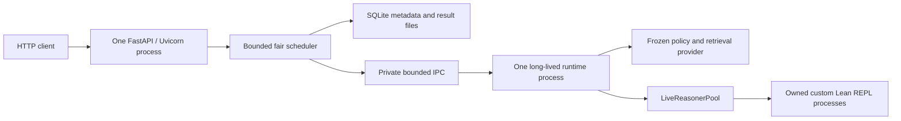

# Dockerized FastAPI service for MCTS actor–critic proving and evaluation

> The follow-up plan `mcts_api_service_remediation_and_pln_deployment.md`
> expands served profiles to PLN and repairs lifecycle/admission guarantees.

## Objective and agreed scope

Expose the existing source-aware `MCTS-AC-branch` proof-search engine through FastAPI/Uvicorn and Docker. Support both PUCT and best-first search, with independently selectable sampled or greedy action proposals. Reuse main's API organization without importing its older client, model, or Lean environment assumptions.

The user selected:

- Single-goal proving, dataset evaluation jobs, and health/readiness for the initial API.
- Persisted job metadata and results. After a service restart, unfinished jobs become interrupted; they do not resume automatically.

Standalone tactic prediction, PLN scoring routes, online training, model uploads, arbitrary model switching, and automatic job recovery are outside the initial scope. Serving uses fixed policy weights and requires kernel-certified proof success.

This document is an architectural plan. Implementation must follow explicit architecture verification and an instruction to proceed.

## Inspected baseline and reusable work

Inspected on 2026-11-02:

| Source | Revision | Relevance |
| --- | --- | --- |
| `MCTS-AC-branch` | `2c8bff8ecf447a9829a3c2246add8229beb66859` | Target runtime, including PR #70 and its validation/lifecycle fixes |
| `main` | `1678cec37893ba7e1090980f6dc058fdbd95396c` | FastAPI app factory, schemas, lifespan pattern, Uvicorn launcher, API tests, Docker/Compose organization |
| `AC-branch` | `25d0039d929453b1d0f7ab33581bfd34ce5ca10b` | Reference for extracting a reusable evaluation runtime; not a commit to merge wholesale |

Read `docs/main_api_mcts_evaluation_assessment.md` before implementation. Its findings about trace schemas, queueing, readiness, cancellation, and main's Docker toolchain remain applicable.

Current MCTS functionality already provides:

- `selection_policy="puct"` with simulation budgets, virtual loss, backed-up edge statistics, and bounded progressive widening.
- `selection_policy="legacy"` for best-first search. It rejects PUCT-only budget and widening fields.
- `EvaluationSettings`, `ProposalSpec`, per-search generators, seeded repeats, and proof-rate reports.
- Complete source-aware action records, stable node candidate pools across widening rounds, and retained snapshots for open proposal sources.
- Replay-based combination and final kernel certification.
- `LiveReasonerPool` ownership, cooperative deadlines, hard-timeout replacement, and one active collection round per pool.

It does not contain main's API implementation. Its standalone evaluation setup is nested inside the CLI. Main's API constructs a different generic prover, uses upstream PyPantograph, and assumes older proof-trace shapes. Main's Docker image builds Lean 4.15 rather than the reviewed custom companion's Lean 4.10.0-rc1.

## Architecture decision and alternatives

Use one Uvicorn API process and one long-lived runtime subprocess. The subprocess owns the GPU policy, retriever, Lean clients, and search event loop. The API process owns HTTP, bounded scheduling, persistent metadata, and result publication.

The process boundary is deliberate: synchronous Torch, FAISS, or Lean setup work can block the search event loop. Keeping that work out of the HTTP event loop preserves responsive health checks, polling, and cancellation requests. A subprocess per request would repeatedly load the model; the selected worker stays loaded between operations.

| Alternative | Advantages | Disadvantages | Decision |
| --- | --- | --- | --- |
| Load everything inside the FastAPI event loop | Fewest components | Synchronous inference/admission can stall HTTP; a lock alone gives no bounded queue | Reject for the intended service |
| Dedicated runtime thread | Separates most event-loop work without duplicating a model | Cannot reliably terminate an unresponsive native operation independently | Defer |
| One long-lived runtime subprocess | Responsive HTTP, one model owner, explicit process recovery and cleanup | Requires bounded IPC and lifecycle supervision | Choose |
| CLI subprocess for every job/request | Simple isolation boundary | Repeated startup, expensive GPU/model duplication, weaker reuse of live workers | Do not use for the primary service |
| External broker and independent distributed workers | Multi-host scaling and durable execution | More infrastructure than requested; automatic durable execution was not selected | Defer |
| Merge all of main into MCTS | Includes all current main features | Imports unrelated runtime/dependency/configuration changes | Reject |

Selectively port main's app factory, lifespan structure, schemas style, launcher, and injected-test patterns. Replace its service implementation and proof response contracts.



## Public API contract

| Route | Behavior |
| --- | --- |
| `GET /health` | Lightweight process liveness; no model or Lean operation |
| `GET /ready` | HTTP 200 only when a validated runtime and usable workers can accept work; otherwise HTTP 503 |
| `POST /prove` | Bounded synchronous single-goal proof request using the shared runtime |
| `POST /evaluations` | Validate and persist a dataset evaluation job, then return HTTP 202 and its identifier |
| `GET /evaluations/{job_id}` | Persisted state, phase, progress, timestamps, resolved settings, and available error category |
| `GET /evaluations/{job_id}/result` | Completed result or explicitly marked partial result for a terminal interrupted/cancelled/failed job |
| `POST /evaluations/{job_id}/cancel` | Request cancellation; return HTTP 202 until execution cleanup finishes |

Use these paths consistently instead of providing duplicate `/mcts/...` aliases. OpenAPI documents the service as MCTS actor–critic proving, with best-first and PUCT profiles.

### Prove request

Accept a goal string and ordered local declarations, a configured search-profile identifier, proposal mode, base seed, and bounded budget overrides. Use strict numeric validation; booleans must not pass as integers. Bound the number/size of declarations, goal size, request body, response diagnostics, and queue depth.

Illustrative request:

```json
{
  "goal": "p",
  "hypotheses": ["p : Prop", "h : p"],
  "search_profile": "puct",
  "proposal_mode": "sample",
  "seed": 42,
  "max_depth": 8,
  "max_nodes": 64,
  "num_simulations": 64,
  "timeout_s": 60,
  "queue_timeout_s": 5
}
```

Input construction and Lean admission must use the existing `lean_replay` and seed-admission validation. Do not duplicate `parse_state()` in HTTP handlers. Preserve typed reconstruction diagnostics, explicit local definitions, and universe handling supported by those shared components. Return a typed input error for context that cannot be faithfully reconstructed.

The server selects the checkpoint, prepared root, imports, REPL, retrieval artifacts, and exclusion policy. Requests cannot provide arbitrary filesystem paths, executable paths, module imports, or checkpoint locations.

### Proof response and error categories

Return certified success separately from graph candidate readiness. Success follows `graph.is_solved()`, not a zero-goal exploratory transition or a READY graph node.

Include request identifier, input identity, resolved search/proposal settings and seed, queue/admission/search timing, authoritative `SearchEndReason`, available execution/search counters, certificate status, exact proof commands, and model/environment/artifact provenance. Preserve the current trace's `command`, nested obligations, and `discharged` entries. Do not split command strings into guessed tactic/argument fields.

Default responses omit the full hypergraph. A deployment may enable bounded diagnostics with explicit size limits. Serialized responses must not contain Torch tensors, retained state handles, active clients, or leases. Provide proof artifacts through their existing serializers where supported; a certificate summary alone is not a portable independent verifier.

| Condition | HTTP/result treatment |
| --- | --- |
| Certified proof or completed bounded search without a proof | HTTP 200 with separate success and termination fields |
| Invalid request shape or inadmissible theorem | HTTP 422 with typed input category |
| Full service queue | HTTP 429 with a retry indication |
| Unready runtime or worker recovery | HTTP 503 |
| Queue or end-to-end request deadline exceeded | HTTP 504; do not label as a mathematical refutation |
| Missing/mismatched deployment artifacts | Runtime readiness failure, not a client theorem error |
| Unknown job | HTTP 404 |
| Result requested before terminal state | HTTP 409 |

Map typed runtime/input failures explicitly. Do not install main's blanket `ValueError -> bad input` behavior.

### Dataset evaluation request

Accept an allowlisted dataset-profile identifier plus bounded search/proposal settings, repeat count, and job deadline. Dataset profiles specify a pinned Hugging Face revision or a mounted theorem JSONL, split, admission limits, exclusions, and evaluation subset settings. Resolve and persist the complete settings at admission; later configuration edits do not change an accepted job.

Preserve MCTS's current evaluation defaults and metric version. Proposal mode defaults to `sample` on this branch. Greedy and sampled proposals are independent of PUCT versus best-first selection. Greedy proposals do not enumerate diverse alternatives merely because a draw count is greater than one.

Record each input/repeat association and resolved search seed before scheduling. Keep repetitions, input occurrences, unique identities, rejected admission rows, and started searches distinguishable. Preserve the current searched-seed proof-rate denominator: inadmissible roots are excluded; started searches that fail or timeout remain accounted for. Record cooperative deadline, hard timeout, infrastructure error, and resource-limit results separately. Do not claim a completed benchmark for a partial job.

## Shared runtime and search profiles

Extract the MCTS-specific validated runtime setup, single-search operation, and evaluation orchestration into reusable modules. Suggested locations:

- `atp_lean_gnn/live_runtime.py`: environment, retrieval, model, and live-pool construction.
- `atp_lean_gnn/evaluation_runtime.py`: admitted single-search and bounded evaluation-chunk operations, typed outcomes and reports.
- `atp_lean_gnn/evaluation_types.py`: immutable request/settings/outcome contracts if needed to avoid circular imports.

Use AC's extracted runtime as a reference, preserving MCTS's cooperative deadline, widening, observations, seed derivation, search counters, result shape, and report metric version. Do not transplant AC's greedy default or its best-first-only execution behavior.

Migrate `--eval-only`, periodic evaluation, and their current callers/tests to this shared runtime in the same change. Reuse an already loaded model/pool for periodic training evaluation. The API child process never constructs an optimizer, calls backward, runs HTPS updates, or synchronizes newly trained weights.

### Validated profiles

Server configuration defines named profiles, initially `puct` and `best_first`:

| Profile | Resolved settings |
| --- | --- |
| `puct` | `selection_policy="puct"`; explicit bounded simulations; batch size, exploration coefficient, and widening bounds validated by current resolvers |
| `best_first` | `selection_policy="legacy"`; simulation, PUCT, and widening fields absent/null |

Use `resolve_search_params`, `resolve_widening`, `RLTrainingConfig.search_kwargs()`, and `EvaluationSettings` as the shared authorities. Reject unsupported combinations instead of ignoring fields. Request overrides may reduce deployment budgets; increases require a configured maximum and validation. Initially keep PLN disabled in the deployed profiles, matching the selected endpoint scope and avoiding an unrequested external symbolic runtime.

The existing reasoner stores search settings at construction. Support profile changes by rebuilding reasoner bindings around the same frozen model/provider and owned server only at an idle pool boundary. Put this operation in the shared pool/runtime ownership layer, not in HTTP-specific mutation code.

The rebind operation must:

1. Reject an active collection, active search, unusable client, or outstanding execution lease.
2. Validate the complete profile and construct replacement reasoners before publishing them.
3. Atomically replace worker bindings and the factory used by later worker replacement.
4. Preserve clients, model generation, devices, provider identity, and close callbacks.
5. Leave existing bindings usable if construction fails before publication.

A deployment uses one active profile per collection chunk. It does not mutate settings during a theorem search or retain graph snapshots between profile switches. Candidate pools and snapshots within a widening search keep their existing ownership and identity guarantees.

### Admission as shared incremental work

Whole-dataset admission can otherwise monopolize the service before any proof search starts. Extract an incremental admission session in the existing admission infrastructure, preserving its cache identity, row accounting, quarantine semantics, input order, and total admission deadline. Both CLI dataset construction and service admission drain the same session.

Advance a bounded number of rows or one bounded admission interval per scheduler operation. Yield only after the current Lean request/scope has settled. Record that paused scheduling still counts against the configured absolute admission deadline. Do not create a second HTTP-only reconstruction path.

At most one admission client is active. Account explicitly for its CPU/RAM/server reservation alongside collection clients; do not hide an extra Mathlib process outside the resource plan. Expose total configured and live client counts in runtime status. Start with one collection worker and capacity for at most one additional admission client.

## Process, scheduling, and cancellation ownership

### Process boundary

Start the runtime subprocess once from FastAPI lifespan, using an explicit process group/session on Linux. The child initializes its own CUDA state, event loop, retrieval provider, and Lean clients. Do not fork a process after creating CUDA models in the API process.

Use a private Unix-domain socket with bounded, length-checked typed messages for commands, acknowledgements, progress, results, cancellation, and shutdown. Keep logs on stdout/stderr, separate from IPC. Messages carry request/job identifiers and a runtime-generation identifier; reject messages from an earlier generation after a restart. Large result artifacts use server-owned files with validated references rather than unbounded messages.

No Torch model, Lean handle, client object, or unbounded graph crosses IPC. The child reports readiness only after artifact, environment, model, provider, and client capability checks succeed. The API process contains no second GPU model.

FastAPI lifespan starts supervision without blocking liveness for the entire model load. `/ready` remains 503 while loading or recovering. Keep the event loop responsive with async IPC and bounded short database operations. Do not rely on FastAPI `BackgroundTasks` as a durable job executor.

Run one Uvicorn process without reload in deployment. Hold an exclusive service-state ownership lock so an accidental second process using the same state directory cannot create another runtime owner. A Uvicorn process count is different from the configured number of Lean collection workers.

### Bounded fair scheduler

The API coordinator owns all proof and evaluation admission. Count queued and active work toward explicit bounds; a semaphore behind an unbounded list of request futures is insufficient.

Only one pool collection operation runs at a time. That operation may use multiple pool workers internally. Interactive requests use a single admitted input; evaluation dispatches bounded input/repeat chunks. Between chunks, select work with a documented fair policy: initially allow at most two interactive requests before one waiting evaluation chunk. Chunk size is bounded by deployment configuration and available workers.

Keep at most one admitted evaluation session resident in the runtime initially. Additional evaluation jobs remain queued. Persist completed attempt results after each chunk; do not retain finished graphs or live snapshots for job polling. Interactive requests may run between admission/evaluation chunks without disturbing an input's prederived proposal seed.

Queue fullness, runtime readiness, and persistent job state are separate concepts. A healthy busy runtime is not dead. Readiness may remain true while requests receive a queue-capacity response.

### Deadlines and cleanup

Start the end-to-end request clock when HTTP admission begins. Enforce a separate maximum queue wait. On dispatch, derive execution time from the remaining total allowance and the configured per-search cap. Include Lean input admission in the request's execution allowance.

Pass monotonic cooperative deadlines into the existing reasoner. Retain the pool's hard-timeout replacement semantics, bounded by the remaining request/job allowance. Parent supervision must not depend on the child event loop responding to cancellation during a synchronous native operation.

On cancellation or hard timeout, keep the runtime/worker lease unavailable until cleanup and replacement finish. `/prove` may return HTTP 504 when its response deadline expires while internal cleanup is still pending; that response must not imply that the worker is immediately reusable. A cancellation job remains `cancelling` until cleanup is acknowledged.

If the runtime fails to settle within the cleanup grace period, terminate its process group, reap it and owned Lean descendants, mark affected active work interrupted, and restart the runtime with a new generation. Do not reuse stale handles or report the interruption as search exhaustion.

HTTP disconnects cancel an interactive request. Disconnects do not cancel an accepted dataset job; the client can poll its identifier later. Define the terminal-state race explicitly: a committed completed result wins over a subsequent cancellation; otherwise cancellation proceeds through cleanup before its terminal commit.

## Persistence and restart behavior

Use SQLite for metadata and server-owned JSON result files under a persistent state volume. The API coordinator is the only job-state writer. Use transactions, a schema version, bounded database waits, and a dedicated execution mechanism for blocking SQLite calls. Do not share a SQLite connection unsafely across threads.

Job lifecycle:

```text
queued -> admitting -> running -> completed
   |          |           |
   +----------+-----------+-> cancelling -> cancelled
   +----------+-----------+-> failed
   +----------+-----------+-> interrupted
```

Persist the original validated request, fully resolved settings, selected dataset revision/content identity, artifact/runtime identities, UTC timestamps, phase/progress, attempt counts, result references, schema versions, and error category. Store proposal-seed derivation and per-attempt provenance with results. Raw runtime handles and optimizer states never enter the store.

Publish result files atomically within the state filesystem, then commit the database reference and terminal state. On startup reconcile files with metadata: uncommitted artifacts do not establish job completion. Preserve usable partial results and label them partial.

After an API-service restart, mark every previously nonterminal job, including queued jobs, `interrupted`. Do not enqueue it automatically. A client must explicitly submit a new job. If only the runtime child restarts while the API remains alive, mark affected active work interrupted; untouched queued work may dispatch normally once readiness returns and its deadline remains valid.

Never recover retained Lean states or snapshots from persistence. Repeated evaluation is a new run with explicit provenance, not a resumed native execution session. Start with configurable retention limits for job rows/result files and an explicit maintenance operation; do not delete results still referenced by active jobs.

## Proposed file and dependency changes

| Area | Files/modules | Work |
| --- | --- | --- |
| HTTP surface | `maths_ai/api/app.py`, `schemas.py`, `__main__.py`, `__init__.py` | Selectively port main's structure; implement the chosen endpoints and MCTS response contracts |
| API coordination | `maths_ai/api/service.py`, `scheduler.py`, `runtime_supervisor.py`, `ipc.py` | Bound admission, fairness, subprocess ownership, IPC, cancellation, and readiness |
| Persistence | `maths_ai/api/job_store.py` | Versioned SQLite records and atomic artifact references |
| Runtime child | `maths_ai/api/runtime_worker.py` | One loaded inference runtime and bounded command execution |
| Service configuration | `maths_ai/api/config.py`, example service JSON | Server-owned paths, search/dataset profiles, budgets, state and queue limits |
| Shared inference | `atp_lean_gnn/live_runtime.py`, `evaluation_runtime.py`, `evaluation_types.py` as needed | Extract current runtime once and reuse it from CLI, periodic evaluation, and worker |
| Shared admission/pool | `seed_admission.py`, `rl_live_collection.py` | Incremental admission and checked idle reasoner rebinding |
| Existing entry points | `rl_training_driver.py`, relevant scripts/tests | Migrate callers to shared construction and evaluation contracts |
| Dependencies | `pyproject.toml`, `uv.lock` | Add compatible FastAPI/Uvicorn; keep HTTPX/testing tools in an appropriate test/dev group; preserve the standalone-client pin |
| Deployment | `docker/Dockerfile`, `docker/entrypoint.sh`, `docker-compose.yml`, `.dockerignore`, `docker/DOCKER.md` | Correct custom Lean runtime, immutable artifacts, one service owner, provisioning and batch profiles |
| Verification/handoff | API, worker, store, runtime and native tests; relevant source manifests; service docs | Verify behavior and extend source-lineage records without rewriting history |

Exact module boundaries can be consolidated during Stage 0, but ownership and shared-code contracts must remain intact. Avoid importing main's old model defaults into `core.config`. Do not keep legacy client/service implementations behind a mode flag.

## Docker and artifact provisioning

### Image organization

Use a pinned base and build tooling, a Lean/runtime build stage, and final API/batch targets sharing the same application dependencies and runtime. `uv sync --frozen` must use this branch's regenerated lockfile. Copy application and required non-Python helpers into the final image; do not rely on missing package-data files or editable installs of source that was not copied.

Build the pinned custom Pantograph fork and matching Mathlib, using the toolchain declared by the selected source revisions. Do not reuse main's Lean 4.15 assumption. Include GNU coreutils `stdbuf`, the required native libraries, `lake`/Lean executables, and compiled dependencies. Verify launchability under the final non-root user's permissions and paths.

Compiled `.lake` files must survive into the final image. A build cache is not a runtime filesystem layer. Check dynamic-link dependencies of the REPL and native components in the final target. Exclude local runs, source checkpoints, data caches, credentials, and unrelated support environments from the build context.

### Deployment artifacts

| Artifact | Runtime requirement |
| --- | --- |
| Version-4 actor–critic checkpoint | Correct graph/vocabulary and retrieval binding |
| Matching prepared root | Required metadata, vocabularies, labels, graph contract, and loader dependencies |
| Query-only directory | Weights, tokenizer/configuration, and manifest |
| Complete lemma index | Vectors, row IDs/names, FAISS file, source and deployment manifests |
| Original lemma corpus | Matching content identity |
| Declaration inventory | Allowed declarations/exclusions and deployed environment identity |
| Lean source root/runtime | Lockfiles, compiled `.olean` artifacts/dependencies, matching toolchain and custom executable |
| Dataset files/cache | Pinned configured inputs; optional offline cache for Hugging Face mode |
| Service configuration | Validated profiles and server-owned paths |

Mount completed artifacts and config read-only. Use separate writable mounts for job metadata/results, caches, and temporary IPC state. Keep source training checkpoints and candidate caches outside the serving image; they are only needed during conversion/provisioning.

The Python deployment identity hashes the custom executable and compiled artifacts. For a rebuilt image, generate the inventory against that runtime, then export query/index deployment bindings and convert the source action checkpoint against the resulting deployment manifest. Alternatively package the exact prior runtime and verify that relocation preserves its bindings. Never edit recorded hashes to bypass checks.

Provisioning is an explicit command/profile, not a hidden download on every API startup. It may need writable index/output directories and the source retriever/action checkpoints; ordinary serving does not. Audit and selectively port AC's declaration-export stack-overflow fix (`dba4f05`) because MCTS currently retains the large recursive export helper. Verify the refined-checkpoint/base-configuration conversion route if provisioning from that source format.

Keep the existing protocol environment identity's limitations visible; deployment-file verification and kernel certification are different checks. Do not claim that a response certificate alone proves an arbitrary external environment has identical contents.

### Compose behavior

- Default API service: one Uvicorn process plus its one owned runtime subprocess; configurable Lean workers inside that runtime.
- GPU configuration: reserve the intended device explicitly; CPU operation is a supported profile. Verify the actual locked Torch/CUDA build and host driver instead of assuming GPU visibility from an image tag.
- Persistent state volume: survives container recreation and stores SQLite/results.
- Readiness healthcheck: request `/ready` and fail on HTTP 503. Liveness is a separate endpoint.
- Graceful stop: allow bounded runtime/client cleanup, then enforce process-group termination.
- Optional explicit provisioning and offline batch-evaluation profiles. Do not implicitly launch a second GPU model alongside the API; use the API job endpoint for evaluation while the service is active.
- Bind the host port to loopback by default; deployment networking and any gateway are explicit configuration.

Preserve main's useful Compose organization, not its old asset bundle or automatic fetch detection.

## Sequential implementation stages

### Stage 0: Contracts, artifact inventory, and baseline tests

Finalize request/result/job schemas, profile resolution, deadlines, fair scheduling, state directory ownership, and IPC envelopes. Record exact dependency/toolchain/source revisions and deployment artifact requirements. Add baseline tests for both selection policies and proposal modes using current MCTS behavior.

Audit every shared runtime/evaluation/admission caller and source-lineage test before moving code. Identify native assets available locally versus required JupyterHub artifacts. Establish what main code is copied and what is replaced.

Exit: architecture and interfaces are explicitly verified; no ambiguity remains about model ownership, supported functions, or restart behavior.

### Stage 1: Shared MCTS inference and incremental admission

Extract validated construction, typed single-search results, bounded evaluation chunks, and admission sessions. Migrate standalone CLI and periodic evaluation to the same code. Implement idle reasoner rebinding with consistent replacement factories and rollback. Preserve seeded proposals, widening candidate-pool identity, retained-source ownership, all search counters, and report/metric semantics.

Exit: CLI behavior remains correct for PUCT/best-first and greedy/sample; a single-item evaluation matches a direct admitted search; no optimizer runs in inference; resource/profile transitions are tested.

### Stage 2: Long-lived runtime process and bounded IPC

Implement child startup, artifact validation, private IPC, readiness handshake, request generations, chunk execution, cancellation messages, worker replacement, and process-group teardown. Keep HTTP-independent integration tests for this protocol.

Exit: one model is loaded per runtime lifetime, HTTP-independent control remains available during a blocked child, stale responses are rejected, and killing/restarting the child leaves no owned Lean processes.

### Stage 3: Persistent job store and fair coordinator

Implement versioned SQLite records, atomic results, queue bounds, fair dispatch, admission/evaluation progress, terminal-state races, cancellation acknowledgement, and restart reconciliation. Keep at most one admitted dataset session resident initially.

Exit: queue overflow is bounded, proofs and evaluations do not starve one another, partial results survive interruption, and restart marks unfinished jobs interrupted without resuming them.

### Stage 4: FastAPI/Uvicorn integration

Port main's app-factory/lifespan/launcher/test patterns and selected dependencies. Implement the agreed routes, typed validation/errors, health/readiness, and native result serialization. Start supervision in lifespan and shut it down through the single owner. Reject multiple owners/reload in deployment configuration.

Exit: OpenAPI matches the actual schemas, readiness reflects usable runtime state, queue deadlines include waiting, and endpoint tests use injectable services without requiring GPU assets.

### Stage 5: Docker and explicit provisioning

Implement pinned multi-stage builds, final-user permissions, custom Lean runtime, frozen Python dependencies, artifact mounts, provisioning commands, batch/API targets, readiness probes, and Compose CPU/GPU profiles. Port required exporter/converter repairs as shared fixes with tests.

Exit: a built image can verify its environment/artifacts and run CLI evaluation before API startup. CPU container smoke passes; GPU smoke is an explicit separate gate on supported hardware. Startup performs no unexpected training-asset download.

### Stage 6: Native API, cancellation, and restart acceptance

Run real HTTP requests through Uvicorn, the runtime child, the pinned standalone client, and the custom REPL. Test conjunction/dependent obligations, replay conflicts/recovery, both selection policies, both proposal modes, resource caps, disconnection, queued expiry, cooperative deadlines, hard cancellation, worker recovery, process restart, and persistent job results.

Exit: certified results serialize correctly; no graph-ready result is reported as proved; repeated workloads restore allocation baselines; one active search owns each reasoner; no stale state survives a runtime generation change.

### Stage 7: Operational handoff

Document build/provision/start commands, artifact/profile configuration, curl examples, evaluation submission/poll/result/cancel, restart semantics, result retention, CPU/GPU expectations, and the differences from main's older endpoints. Update the assessment with implementation links while preserving its historical findings.

Exit: another contributor can deploy from the pinned inputs and reproduce a controlled proof and dataset job without access to developer-specific paths.

## Verification matrix

| Area | Required evidence |
| --- | --- |
| Configuration | PUCT/legacy conditional validation; strict mode/seed/repeat checks; deployment caps and path ownership |
| Shared search | Same admitted input/proposal/budgets produce equivalent CLI and service behavior; seeded draws independent of scheduling |
| Inference | No optimizer construction/steps/backward; frozen weights and stable candidate/library bindings |
| Proof semantics | Exact command/discharge traces; candidate readiness separated from kernel-certified success |
| Worker lifecycle | Rebinding only while idle; recovery factory follows selected profile; cleanup on error and repeated cancellation |
| Responsiveness | Liveness/readiness/polling remain responsive during synchronous child inference and a deliberately blocked child |
| Deadlines | Queue wait included; bounded execution; cooperative result preserved; hard timeout/recovery not counted as refutation |
| Jobs | Transactional state transitions, atomic result visibility, cancellation/completion race, interrupted restart behavior |
| Scheduling | Bounded pending work, declared fairness, prederived seeds, bounded admission/evaluation chunks |
| Persistence | Crash between result publication and metadata commit; missing/corrupt artifacts; no recovery of native handles |
| Docker | Correct toolchain/native links, final-user access, runtime `.lake` contents, no assets accidentally hidden by mounts |
| End-to-end | Real Uvicorn + child + custom REPL for controlled proofs and a small evaluation; GPU/trained-artifact trial reported separately |

Use the full existing inference suite and new API/store/worker suites. Extend source manifests when hash-tracked files change; do not rewrite historical manifests to conceal adaptations. Keep controlled synthetic-policy tests separate from claims about trained-model solve rate or throughput.

## Completion criteria and practical limits

The feature is complete only when the chosen routes work through the shared MCTS runtime, persistent jobs follow the selected restart contract, the Docker image uses a compatible bound deployment, and native lifecycle/certification tests pass. Endpoint tests with fake services alone are insufficient.

No cloud infrastructure, distributed queue, automatic continuation of interrupted Lean searches, model training, retriever retraining, new search algorithm, or standalone prediction/PLN endpoint is required. Authentication/TLS gateways and multi-host scaling remain deployment extensions rather than implicit promises of this initial service.

## References

- Repository assessment: `docs/main_api_mcts_evaluation_assessment.md`.
- [FastAPI lifespan documentation](https://fastapi.tiangolo.com/advanced/events/): use lifespan-managed startup/shutdown ownership.
- [FastAPI worker-process deployment documentation](https://fastapi.tiangolo.com/deployment/server-workers/): process replication is separate from this runtime's Lean worker count.
- [Docker Compose GPU support](https://docs.docker.com/compose/how-tos/gpu-support/): explicit GPU reservations require a suitably configured host and device capabilities.

This plan was produced through source inspection and the user's scope decisions. It does not claim an API implementation, a successful Docker build, or a live HTTP-to-trained-model benchmark.
